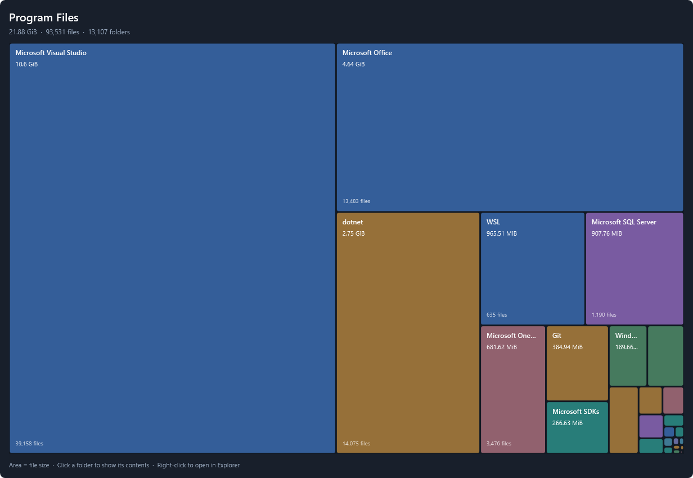

# DiskSpaceMap

A fast Windows disk-space visualizer with interactive treemaps, folder drill-down,
and standalone x64 and ARM64 builds.

DiskSpaceMap helps you find the folders and files taking up space on a drive.
Each rectangle represents an item, and its area is proportional to its file size.
Click a folder to make it the map's current scope and see the items immediately
inside it. Keep clicking to explore as deeply as you need.

## What it does

- Select a drive from the dropdown. The app selects `C:\` and starts scanning on launch.
- See top-level blocks appear early and adjust as sizes are measured.
- Click folders to drill down; use **Up**, **Root**, or the breadcrumbs to navigate back.
- Refresh the current folder and all its descendants with **Refresh** or **F5**.
- Keep the existing map visible during refresh, with updated sizes and contents when it finishes.
- Right-click a block to open its location in Windows Explorer.
- Hover over any block, including tiny unlabeled ones, to see its full name, path, size, and available actions.
- Inspect, filter, and sort the item list beside the map.
- Stop a scan and inspect the partial results. Stopping a refresh retains the previous view.

The app analyzes disk usage locally and does not delete or modify your files.
If you change files in Explorer, refresh the relevant folder to update the map.

## Download and run

Download a Windows ZIP from [Releases](https://github.com/pilcherd/DiskSpaceMap/releases)
and extract it:

| Your Windows PC | Download |
| --- | --- |
| Intel or AMD 64-bit PC | `DiskSpaceMap-1.0.0-win-x64.zip` |
| ARM64 PC, such as a Snapdragon Windows laptop | `DiskSpaceMap-1.0.0-win-arm64.zip` |

Run `DiskSpaceMap.exe`. The executable includes the .NET runtime and WPF, so you
do not need to install .NET. Its bundled files are extracted to your user
temporary directory on first launch and reused on subsequent launches.

Releases are unsigned. You can also [build from source](BUILDING.md) with the
.NET 11 SDK. The app is developed and tested on Windows 11.

## Understanding the numbers

- Sizes are **logical file lengths**, not allocated disk space. Sparse,
  compressed, and online-only files can use less physical storage.
- Hard-linked files are counted per directory entry.
- Directory links and junctions are skipped to avoid cycles and scanning outside
  the selected tree.
- Protected or unreadable folders can be incomplete. **Scan details** shows
  errors and skipped-link counts for the latest scan or refresh.
- Filesystem metadata and alternate data streams are not included. The total
  can differ from Windows' reported drive usage.
- Very large item lists can be grouped on the map to keep rendering responsive;
  the item list still exposes individual entries.

## Built for fast scanning

DiskSpaceMap uses Windows directory enumeration and a small automatic worker
pool. It reads directory metadata without opening every file's contents. Progress
updates and map rendering are bounded to keep the interface responsive on large
drives. Completed scan data supports drill-down without rereading each folder.

The app is written in C# with .NET 11 and WPF. Standalone releases use
ReadyToRun ahead-of-time compilation; they are not Native AOT builds.

## Development and releases

See [BUILDING.md](BUILDING.md) for building, running the automated checks, and
preparing a release. GitHub Actions builds and verifies Windows x64 and ARM64
packages. Pushing a matching version tag publishes a release after both architecture builds and all checks succeed.

Bug reports and contributions are welcome through
[Issues](https://github.com/pilcherd/DiskSpaceMap/issues) and pull requests.
When reporting a problem, include the app version, Windows architecture, what
you did, and any relevant scan details. Remove personal paths from screenshots
or logs before sharing them.

## License

DiskSpaceMap is available under the [MIT License](LICENSE).
Standalone release archives also include the bundled .NET runtime's license
and third-party notices.
